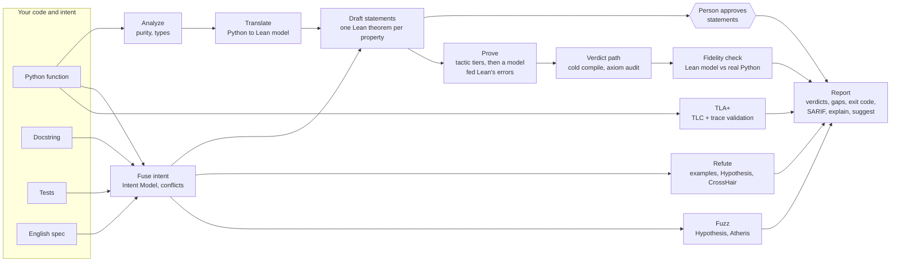

# Apex

### Democratizing Formal Verification for the Agentic Era

**Apex checks whether your Python code does what you said it should. Where it can, it proves it
the way mathematicians prove theorems. Where it can't, it says so plainly.**

You give Apex a function and whatever description of its behaviour you already have: a
docstring, a few tests, a couple of sentences in plain English. Apex turns that description into
precise mathematical statements and works on them, and comes back with one of three answers:

- ✅ **Proven.** A machine-checked proof, in the Lean 4 proof assistant, that the code always
  meets the statement, for every possible input, not just the ones a test happened to try.
- ❌ **Refuted.** A concrete input that makes your real code misbehave, plus a ready-made
  regression test that reproduces it.
- ⚠️ **A gap.** An honest "I couldn't establish this", with the reason and what would have to
  change.

You don't need to know Lean or any formal methods. Apex writes the theorems and searches for the
proofs, with help from an AI model if you have one. It asks a person for one thing only: to
confirm that each statement says what the code is *meant* to do.

```
$ apex check shapes.py
                            Apex 0.1.0.dev0 · exit 1
│ shapes.clamp │ P1 │ proven_unreviewed │ statement pending: run `apex review shapes.py::clamp --approve P1` │
│ shapes.clamp │ P2 │ refuted           │ input (x=1, lo=0, hi=1): lo <= x <= hi -> r == x; returns 0          │
│ shapes.clamp │ E1 │ refuted           │ input (x=5, lo=0, hi=3): 3; returns 2                                │
  fidelity shapes.clamp: Lean model agrees with Python on 200 generated inputs
```

> **Status:** research prototype, MIT-licensed, not on PyPI yet. Start with the
> [quickstart](docs/QUICKSTART.md), and read [what Apex cannot prove](docs/LIMITS.md) before
> relying on a verdict.

---

## Contents

- [The problem: correctness in the age of AI coding](#the-problem-correctness-in-the-age-of-ai-coding)
- [How Apex answers it](#how-apex-answers-it)
- [What you get back](#what-you-get-back-verdicts)
- [Install](#install)
- [Quick start](#quick-start)
- [Telling Apex what the code should do](#telling-apex-what-the-code-should-do)
- [Using Apex](#using-apex)
  - [On the command line](#on-the-command-line)
  - [With a model doing the hard parts](#with-a-model-doing-the-hard-parts)
  - [Inside a coding agent](#inside-a-coding-agent-skill-and-mcp)
  - [Beyond Lean: fuzzing and TLA+](#beyond-lean-fuzzing-and-tla)
  - [In CI](#in-ci)
  - [Configuration](#configuration)
- [How it works](#how-it-works)
- [Design principles](#design-principles)
- [What you are trusting](#what-you-are-trusting)
- [Limits](#limits)
- [How well it works](#how-well-it-works)
- [Development](#development)
- [Project status](#project-status)
- [License](#license)

---

## The problem: correctness in the age of AI coding

Software is increasingly written by coding agents. A one-line prompt produces a working-looking
function in seconds, and an agent can produce hundreds of them in an afternoon. That changes
where the hard part of programming lives. Writing code is no longer the bottleneck. Knowing
whether the code is right is.

The usual safety nets were built for a slower world, and they strain under this one:

- **Review doesn't scale with generation.** People can't read code as fast as agents write it,
  and generated code *looks* right. It is idiomatic, well-named and confidently commented,
  which makes it easy to skim past an off-by-one.
- **Tests check examples, not behaviour.** A test suite tries a handful of inputs someone
  thought of. Bugs live in the inputs nobody thought of: the empty list, the negative number,
  the boundary.
- **The agent often grades its own homework.** When the same model writes the code and the
  tests, they share the same blind spots. "All tests pass" can mean very little.
- **"It works" is a claim, not evidence.** An agent saying it verified something is just more
  generated text.

The strongest safety net we have is **formal verification**: a mathematical proof, checked by a
machine, that code meets its specification for *every* input. It has protected operating-system
kernels, compilers and cryptography for decades. But it has stayed out of reach for ordinary
code, because it needs specialists to write formal models, state theorems in a proof assistant's
language and prove them by hand. That is weeks of expert work for a single function.

The agentic era makes this both **more necessary** (more code than anyone can review) and
**newly possible** (AI models are good at the tedious parts of formal work). What has been
missing is a way to let models do that work without letting them decide whether it is correct.

## How Apex answers it

Apex splits the job three ways, so that no single party has to be trusted with everything:

| Role | Who | What they do |
|---|---|---|
| **Propose** | an AI model, your coding agent, or Apex's own heuristics | turn English into formal statements, suggest proofs, draft specs |
| **Decide** | Lean 4, a fixed verdict path, and your real Python code | check every proof cold, audit its axioms, run the real code to confirm or refute |
| **Approve** | a person | confirm that each statement says what the code is *for* |

A model can make Apex faster, but it can never make Apex say `proven`. Only a Lean proof of a
person-approved statement does that. Everything else gets an honest label: a bug Apex watched
happen, evidence from fuzzing or model checking, or a gap with a reason.

That is what "democratizing" means here: no proof expertise needed, the same guarantees a
verification engineer would insist on, and it meets you where you already work. That means the
command line, CI, or your coding agent: it is tested end to end in Claude Code and Codex, and it
also installs for Gemini CLI, Cursor and VS Code.

Who it is for:

- **Developers** who want more than tests on the functions that matter: arithmetic, bounds,
  sorting, encoders, small algorithms.
- **Teams using coding agents.** The agent writes the code, Apex checks it, and the agent reads
  the counterexample and fixes it. This closed loop has been demonstrated in Claude Code and
  Codex.
- **CI pipelines** that need a machine-readable answer (exit codes and SARIF), not someone's
  impression.

## What you get back: verdicts

Every property gets exactly one verdict. The names are part of the contract and every renderer
shows them verbatim.

| Verdict | Meaning | Exit |
|---|---|---|
| `proven` | Lean proved a statement a person approved. Only standard axioms were used, and the Lean model of the function agreed with the real Python on generated inputs. | 0 |
| `refuted` | A concrete input (or, for concurrent code, a recorded run) on which the real Python breaks the property. Apex watched it happen. | 1 |
| `contradiction` | Two of your intent sources disagree, e.g. the docstring says `f(2) == 6` and a test says `f(2) == 5`. | 1 |
| `fidelity_failed` | The model Apex reasoned about (Lean model or TLA+ spec) does not match the real code, so any result about it was discarded. | 1 |
| `proven_unreviewed` | Lean proved it, but nobody has approved the statement yet. | 2 |
| `proven_conditional` | Proven only under an assumption the code does not state. | 2 |
| `unproven` | No proof and no counterexample within budget, with a reason code. | 2 |
| `out_of_scope` | Apex cannot model this code faithfully (I/O, floats, unsupported constructs), with a reason code. | 2 |
| `fuzzed` | Lean couldn't decide it. A recorded fuzzing campaign on the real code found no counterexample. Evidence, not proof. | 2 |
| `model_checked` | Concurrent code: TLC found no violation of its TLA+ spec within bounds, and real runs match the spec. Evidence, not proof. | 2 |

Exit codes for a whole run: **0** means every approved property is proven, **1** means any
failure, **2** means gaps only, and **3** means a tool error (missing Lean, bad config, a crash,
a timeout).

- Failures always win over gaps.
- A function with no intent counts as a gap, so a run can't pass by checking nothing.
- `fail_on` in the config can promote chosen gaps to failures.

## Install

Requirements:

- Python 3.12+ and [uv](https://docs.astral.sh/uv/).
- [elan](https://github.com/leanprover/elan), the Lean toolchain manager.
- About 5 GB of disk once, for the pinned Lean toolchain and the prebuilt Mathlib cache. They are
  shared by every project.
- Optional:
  - Java 11+ for TLA+;
  - a libFuzzer-capable clang for Atheris (on macOS, Homebrew LLVM);
  - a model provider (Claude Code or Codex logged in, or an API key).

Apex is not on PyPI yet; install it from a checkout:

```sh
git clone https://github.com/HyperionAI-Tech/apex && cd apex
uv build && uv tool install dist/apex_verify-*.whl
apex init            # writes apex.toml, fetches the pinned Lean toolchain + Mathlib cache
apex doctor          # everything should be "ok"; optional extras show "warn"
```

Optional extras:

```sh
apex init --tla                                    # pinned TLA+ tools (TLC v1.7.4, checksum-verified)
uv tool install 'dist/apex_verify-*.whl[fuzz]'     # Atheris; on macOS first:
                                                   #   export CLANG_BIN=$(brew --prefix llvm)/bin/clang
```

`apex init` installs into `~/.apex` (`APEX_HOME` moves it), outside the package, so upgrading
Apex keeps the cache. Until it has run, the Lean commands exit 3 with a pointer to `apex init`;
refutation and fuzzing work without Lean. Windows is supported through WSL.

To develop on Apex itself: `uv sync --all-extras && uv run apex init`.

## Quick start

Write a function and say what it should do. Here the docstring does that:

```python
# shapes.py
def clamp(x: int, lo: int, hi: int) -> int:
    """Limit x to the range [lo, hi].

    pre: lo <= hi
    post: lo <= __return__ <= hi
    post: lo <= x <= hi -> __return__ == x

    >>> clamp(5, 0, 3)
    3
    """
    return max(lo, min(x, hi))
```

```sh
apex check shapes.py          # P1, P2 (the post: lines) and E1 (the doctest): proven_unreviewed, exit 2
apex review shapes.py::clamp  # read each statement, in English and in Lean
apex review shapes.py::clamp --approve P1,P2,E1   # in your own terminal
apex check shapes.py          # proven, exit 0
```

Now break it, changing `min(x, hi)` to `min(x, hi - 1)`, and check again. P2 and E1 become
`refuted` with concrete inputs, while P1 (the result stays in range) is still true. Then:

```sh
apex explain                  # what each verdict means, in plain English
apex suggest                  # what to change, plus a pytest regression test per counterexample
```

The [quickstart](docs/QUICKSTART.md) walks through this with real output.

## Telling Apex what the code should do

Apex never infers intent from the code alone; that would only prove the code does what it does.
It reads the intent you already have, from four sources, and fuses it into one **Intent Model**:

| Source | Where | What Apex reads |
|---|---|---|
| Docstring | the function | doctests (examples); `pre:` / `post:` lines (formal properties) |
| Tests | `test_<module>.py`, next to the module or in `tests/` | `assert f(...) == v` and `parametrize` rows (examples); Hypothesis `@given` tests (properties) |
| English spec | `<module>.spec.md` | one requirement per list item; a formal reading in backticks makes it checkable |
| Source | the function | leading `assert`s (preconditions) |

A formal hint is a Python boolean expression over the parameters and `r` (the result, or
`__return__` in a docstring), with `->` for "implies":

```markdown
## clamp
- Requires: the range is not empty. `lo <= hi`
- The result lies in [lo, hi]. `lo <= r <= hi`
- Values already in range come back unchanged. `lo <= x <= hi -> r == x`
- It should be fast.            <- no hint: kept as text-only intent (SPEC_AMBIGUOUS)
```

- **Shared claims merge.** The same claim from two sources becomes one property that cites both.
- **Disagreements stop.** When sources disagree, both properties are `contradiction`, and nothing
  about them is checked until you decide which source is right.
- **Models can help.** A model can turn English without a hint into one (`apex intent propose`);
  the result is still only a draft that you approve.

## Using Apex

### On the command line

One command does everything, and each stage is also its own command:

```sh
apex check src/                       # the whole pipeline over files or a package
apex check src/ --sarif apex.sarif    # ... plus SARIF for code-scanning UIs
apex report | explain | suggest       # the last report; plain English; concrete next steps
```

```sh
apex analyze  mathx.py::clamp         # purity, the Lean model, the fused Intent Model
apex scaffold mathx.py::clamp         # writes .apex/lean/mathx/clamp/{Model,Spec}.lean
apex review   mathx.py::clamp         # statements with their review status
apex prove    mathx.py::clamp --tactics-only   # cheap deterministic tactics, then verify
apex verify   mathx.py::clamp         # cold Lean compile + axiom audit + fidelity + refutation
apex refute   mathx.py::clamp         # counterexample search on the real Python only
```

Targets are `path.py::function`. Every command takes `--json` (schemas are published in
`schemas/`), and `report`/`check`/`verify` also take `--markdown`.

### With a model doing the hard parts

Two steps can use a model: formalizing English into hints, and proposing proofs the tactics
can't find. Both are opt-in, and the model can be reached any of these ways:

| `model_provider` | How |
|---|---|
| `claude-code`, `codex` | the coding agent you already have installed and logged in, run headless |
| `anthropic`, `openai` | an API key (`ANTHROPIC_API_KEY` / `OPENAI_API_KEY`) |
| `host` | the agent driving Apex writes hints and proofs itself |
| `none` (default) | no model; every deterministic step still runs |

```sh
apex check src/ --provider claude-code    # formalize, prove with Lean's errors fed back, verify
```

A model's proof is held to the same rules as a hand-written one:

- It is refused before Lean runs if it changes an approved statement or uses a forbidden token
  (`sorry`, `native_decide`, `axiom`, ...).
- Lean's errors and goal states go back to the model for a few more attempts.
- Whatever compiles is judged by the same cold verdict path as anything else.

### Inside a coding agent: skill and MCP

```sh
apex skill install --with-mcp     # the apex-verify skill + the `apex` MCP server, for every harness
```

This installs one canonical [Agent Skill](skill/apex-verify/SKILL.md) that Claude Code, Codex,
Gemini CLI, Cursor and VS Code/Copilot all read, and merges an `apex` entry into each
harness's MCP config. Existing entries are never overwritten. Then ask your agent, in your own
words, to verify a function. The skill:

- runs the pipeline;
- shows Apex's table verbatim;
- asks *you* to approve statements. No tool can approve on your behalf; approval needs an
  interactive terminal.

The MCP server (`apex mcp`) exposes the deterministic commands as typed tools: `apex_analyze`,
`apex_verify`, `apex_refute`, `apex_fuzz`, `apex_tla_check` and more. Rejected proofs come back
with Lean's errors mapped to the line the agent edits, and the goal state. The smoke test
matrix runs real Claude Code and Codex sessions through the full loop: write code, fail
verification, read the counterexample, fix, pass.

### Beyond Lean: fuzzing and TLA+

Lean only models a pure subset of Python. For the rest, Apex gathers **evidence** and labels it
as such. It never upgrades evidence to `proven`.

**Fuzzing**, for pure code outside the subset (`while` loops, indexing, idiomatic agent code) or
properties Lean left open:

```sh
apex fuzz loops.py::isqrt --seconds 30          # Hypothesis campaign, recorded per property
apex fuzz loops.py::isqrt --engine atheris      # coverage-guided libFuzzer
apex check src/ --fuzz 10                       # fuzz whatever Lean leaves open
```

- A clean campaign gives `fuzzed`, with the engine, the number of executions, and how many
  inputs were skipped.
- A counterexample is replayed on the real code and gives `refuted`.
- The evidence lapses when the function or the property changes.

**TLA+**, for concurrent code (threads, locks, shared state). A function gets a bundle in
`.apex/tla/<module>/<function>/` with three files:

- `Spec.tla`, the spec (PlusCal is fine);
- `Spec.cfg`, the bounds and invariants;
- `harness.py`, which runs the real code and reports its shared state.

```sh
apex tla draft workers.py::worker               # a model drafts the bundle (or write it yourself)
apex review workers.py::worker --approve T_NoLostUpdate   # you approve the whole bundle
apex tla check workers.py::worker               # TLC on the spec, then the real code against it
```

TLC explores every state of the spec within the bounds. Apex then runs the real code many times
under varied thread schedules, and has TLC check that every recorded run is a behavior the spec
allows:

| What happened | Verdict |
|---|---|
| no violation, and every run matches the spec | `model_checked` |
| an invariant broke in a real run | `refuted` |
| a real run the spec doesn't allow | `fidelity_failed` |
| TLC found a violation no real run showed | `unproven`, with TLC's trace |

### In CI

```yaml
- run: apex check src/ --sarif apex.sarif   # exit 1 fails the job; gaps (exit 2) pass unless fail_on says otherwise
- uses: github/codeql-action/upload-sarif@v3
  if: always()
  with: { sarif_file: apex.sarif }
```

- **SARIF levels.** In SARIF the verdict is the rule ID. Failures are errors and `unproven` is a
  warning. Evidence verdicts are notes, and proofs carry level `none`.
- **Approvals.** Approvals live in `.apex/reviews.json`; commit it and `proven` reproduces in CI
  without anyone at a terminal.

### Configuration

`apex init` writes an `apex.toml`; every key is optional:

```toml
[apex]
model_provider = "none"            # none | claude-code | codex | anthropic | openai | host
# model = "..."                    # unset: the provider's default
proof_budget_s = 120               # per theorem: Lean time for one compile of its proof
refute_budget_s = 10               # CrossHair time per property
fuzz_budget_s = 30                 # per property: one `apex fuzz` campaign
fuzz_engine = "hypothesis"         # or "atheris"
retries = 4                        # model proof attempts after the first, each fed Lean's errors
llm_parallel = 4                   # theorems a model works on at once
confidence_floor = 0.6             # below this, a property is flagged SPEC_AMBIGUOUS
fail_on = ["refuted", "fidelity_failed", "contradiction"]
review_store = ".apex/reviews.json"
ignore = ["tests/**", "migrations/**"]
```

## How it works



1. **Analyze.** Apex resolves the target, classifies purity (I/O, globals, randomness,
   concurrency, floats), and keeps the reason and the pure core when a function is impure.
2. **Translate.** It turns the function into a Lean model. The translator accepts a deliberately
   small subset (ints, bools, lists, tuples, `Optional` returns, `if`, `for` loops, list
   comprehensions, calls within the module) and refuses anything it can't model *exactly*. It
   never approximates.
3. **Fuse intent.** All four sources become one Intent Model with stable property IDs (P1, P2,
   ...; E1, ... for examples), confidence scores, and conflicts called out.
4. **Draft statements.** Each formal hint becomes a Lean theorem, translated by the same code as
   the function, so the statement and the model speak the same language. The theorems are
   written to `.apex/lean/<module>/<function>/Spec.lean`.
5. **Approve.** A person reads each statement in English and in Lean and approves it in an
   interactive terminal. Approval is tied to a hash of the function and the statement, so an
   edit to either voids it.
6. **Prove.** Cheap deterministic tactic tiers go first (`decide`, `omega`, `simp`, induction),
   then optionally a model, in a fixer loop that reads Lean's errors and goal states.
7. **Verdict path.** Only one function can say "proved". It compiles the spec cold in a clean
   directory, screens for tricks (`sorry`, `native_decide`, forged output, kernel-skipping
   options), and audits every theorem's axioms against a fixed allowlist.
8. **Fidelity check.** The compiled Lean model and the real Python run on 200 generated inputs,
   restricted to the preconditions. Any disagreement discards the proof as `fidelity_failed`.
9. **Refute and fuzz.** Independently of Lean, Apex searches the real Python for counterexamples
   with doctest and test examples, Hypothesis and CrossHair, plus optional fuzzing campaigns.
   Every counterexample is replayed before it is reported.
10. **Report.** Verdicts, reason codes, next steps and exit code go out in Rich, Markdown, JSON
    or SARIF.

Concurrent code takes the TLA+ path instead (see [above](#beyond-lean-fuzzing-and-tla)).

The code is organized in layers:

| Layer | Package | Role |
|---|---|---|
| Contracts | `apex.core` | verdicts, reason codes, Intent Model, report, config, JSON Schemas |
| Understanding | `apex.analyze`, `apex.intent`, `apex.translate` | purity, intent mining and fusion, Python to Lean |
| Proving | `apex.theorems`, `apex.prove`, `apex.lean` | statements and review store, proof search, pinned Lean project, verdict compiler |
| Checking the real code | `apex.fidelity`, `apex.tla` | fidelity bridge, refutation, fuzzing; TLA+ bundles, TLC, trace validation |
| Models | `apex.llm` | providers: agent CLIs or API keys (proposals only) |
| Surfaces | `apex.cli`, `apex.mcp`, `apex.skill`, `apex.report` | CLI, MCP server, Agent Skill installer, renderers |
| Orchestration | `apex.pipeline` | the deterministic verbs every surface calls |

Every surface (CLI, MCP, skill) calls the same pipeline functions, so they cannot drift apart.
Deeper internals are in [docs/ARCHITECTURE.md](docs/ARCHITECTURE.md): the verdict path step by
step, spec files as a trust boundary, the model proof loop, and the TLA+ conformance check.

## Design principles

1. **Lean is the only source of `proven`.** Nothing else can produce it: not a model, not an
   agent, not a test campaign, not TLC.
2. **Models propose; checkers decide.** Every model output (hints, proofs, TLA+ bundles) goes
   through a deterministic check before it can affect a verdict.
3. **A person approves meaning.** A machine can check that a proof is valid. Only a person can say
   whether a statement is what the code is *for*. Approval needs an interactive terminal, so an
   agent can never approve its own work.
4. **Gaps are first-class output.** `unproven`, `out_of_scope` and the evidence verdicts carry a
   reason code and next steps. Exit 0 can't happen by checking nothing.
5. **Evidence is labeled as evidence.** Fuzzing and model checking produce `fuzzed` and
   `model_checked`, which are gaps, never passes.
6. **Refusing beats approximating.** A construct the translator can't model exactly is a gap,
   because a proof about the wrong model is worse than no proof.
7. **Every model is checked against the real code.** Lean models are cross-checked by the
   fidelity bridge, and TLA+ specs by trace validation.
8. **Failures are observed, never inferred.** `refuted` means Apex ran the real code and watched
   it break the property. A violation found only in a model stays a gap.
9. **Everything is pinned.** Lean, Mathlib and TLC are pinned by version and checksum, and
   upgrades are deliberate changes re-run against the eval corpus.

## What you are trusting

A `proven` verdict rests on these:

- **The Lean 4 kernel and the pinned Mathlib.** The axiom audit allows only `propext`,
  `Classical.choice` and `Quot.sound`.
- **The approved statement.** Lean proves exactly what it says, so a statement weaker than your
  intent gives a proof of the weaker thing. That is why you read it before approving.
- **The translator.** The proof is about Apex's Lean model of your function. The fidelity check
  tests the model against the real Python, but testing isn't proof. The translator stays small
  and refuses rather than guesses to keep this risk low.
- **Partial correctness.** Preconditions (leading `assert`s, `pre:`, "Requires:") bound every
  claim. Outside them the function promises nothing.

`model_checked` additionally rests on the approved harness (its `observe()` defines what
"conforms" means) and on the bounds in `Spec.cfg`.

## Limits

The short version (the full list is in [docs/LIMITS.md](docs/LIMITS.md)):

- **The Lean subset is small.**
  - Not supported: `str`, `float`, `dict`, `set`, classes, `while` loops, recursion, indexing,
    early `return` in loops, exceptions, module constants, and calls into other modules.
  - Many functions fit after a small rewrite (a `for` loop over a `range`, an accumulator). The
    gap message points at the line.
- **Idiomatic code often falls outside it.** Of 10 functions written by Claude Code and Codex
  from one-line prompts, 3 fall inside the subset. The other 7 get refutation and fuzzing, not
  proofs.
- **Performance claims have no formal reading.** "Runs in linear time" stays text-only.
- **`fuzzed` can sit on top of a bug.** A 20-second campaign once missed a planted bug that a
  60-second one finds.
- **`model_checked` holds within bounds only.** Two threads and two iterations is not N threads.

## How well it works

The eval corpus gates every phase:

- 49 known-good functions with hand-written Lean reference statements;
- 33 planted bugs;
- 15 spec/code conflicts;
- 15 out-of-scope functions;
- 10 unedited agent-written functions;
- 4 concurrent functions with TLA+ bundles.

`uv run python evals/run.py --jobs 4` prints this scoreboard (tactics only, no model):

| | |
|---|---|
| **false `proven`** (must be 0) | **0** |
| **false evidence**: `fuzzed`/`model_checked` on a property that must fail (must be 0) | **0** |
| cases matching their expected verdicts | 126 / 126 |
| planted bugs caught with a counterexample | 53 / 53 |
| spec/code conflicts detected | 18 / 18 |
| out-of-scope functions with the right reason code | 15 / 15 |
| drafted statements Lean shows equivalent to the hand-written reference | 56 / 82 |
| true properties proven | 113 / 217 (tactics alone) |
| evidence verdicts | 20 `fuzzed`, 3 `model_checked` |
| median time per function | 7.9 s |

With a model in the proof loop (`--provider claude-code`), the earlier 46-case corpus went from
56/82 to 82/82 true properties proven, with false `proven` still 0. That run hasn't been
repeated on the full corpus yet.

## Development

```sh
uv sync --all-extras && uv run apex init      # add `apex init --tla` for the TLA+ tests
uv run pytest -m "not lean and not install"   # unit tests (TLA+ tests skip without Java/TLC)
uv run pytest -m lean                         # Lean canaries and end-to-end tests
uv run pytest -m install                      # builds the wheel and drives the installed binary
uv run python evals/run.py --jobs 4           # the eval corpus and scoreboard
uv run python evals/smoke/run.py              # real agents drive the skill (spends model usage)
uv run ruff check . && uv run pyright
```

The canaries include proofs that try to cheat (`sorry`, `admit`, `native_decide`, a user
`axiom`, a forged audit line). Each asserts that the axiom audit alone rejects it, so a guard that
happens to fire first can never hide a regression in the trust anchor.

```
src/apex/        the package (see "How it works")
lean/            the pinned Lake project: Lean v4.35.0, Mathlib v4.35.0, the Apex prelude
skill/           the canonical apex-verify Agent Skill
packaging/       generated Claude Code plugin and Gemini CLI extension
evals/           the corpus, the runner, and the agent smoke matrix
schemas/         JSON Schemas for every --json output
docs/            quickstart, limits, architecture
tests/           unit, Lean, install and TLA+ tests; canaries; TLC output fixtures
```

## Project status

Apex has been built phase by phase against the development handoff:

| Phase | Delivered |
|---|---|
| 0 | Lean harness: pinned toolchain, cold verdict compiler, axiom audit, canary suite |
| 1 | Python spine: translation, statements, review, fidelity bridge, first proofs |
| 2 | Four intent sources, fusion and conflicts, refutation, model providers |
| 3 | `apex check`, model proof search, SARIF, the exit-code contract |
| 4 | MCP server and Agent Skill, verified in Claude Code and Codex |
| 5 | Hardening: the 126-case corpus, quickstart, limits page |
| 6 | Beyond Lean: fuzzing campaigns and TLA+ for concurrent code |

Still open:

- **Decisions:** the PyPI package name (`apex-verify` is a placeholder), the default model
  provider, the maturity claim, and the skill's distribution channels.
- **Not yet verified:**
  - the CI jobs for TLA+ and Atheris;
  - a native Linux install;
  - the API-key providers;
  - the Gemini extension format.

## License

Apex is released under the [MIT License](LICENSE).
