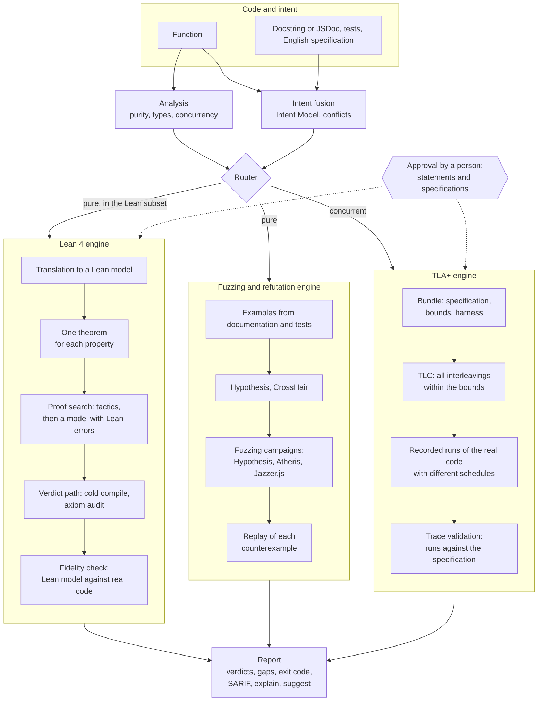

# Apex

### Democratizing Formal Verification for the Agentic Era

Apex verifies Python, JavaScript and TypeScript functions against a statement of their intended
behavior. It uses three verification engines and gives one report.

| Engine | Function | Question that it answers |
|---|---|---|
| Lean 4 theorem prover | Proves a property for all inputs. | Is the property true for every input? |
| TLA+ model checker (TLC) | Examines all thread interleavings of a concurrent function, within set bounds. | Can a thread schedule break the property? |
| Fuzzing and refutation | Runs the real code with generated, coverage-guided and symbolic inputs. | Is there an input that breaks the property? |

**Apex uses the intent that your project already has.** You do not write a formal
specification. Apex reads the intent from these sources and combines it into one set of
properties:

- **Specifications in English.** A Markdown file next to the module (`<module>.spec.md`) with
  one requirement for each list item.
- **Documentation in the code.** Docstrings and JSDoc: examples, doctests, `@example` tags, and
  `pre:` and `post:` lines.
- **Tests.** pytest, Hypothesis, Jest, Vitest, node:assert and fast-check.
- **The code.** Assertions and guards at the start of a function (preconditions).

When two sources disagree, Apex reports the conflict. It does not select one source.

**Apex operates in your coding agent.** One command (`apex skill install --with-mcp`) installs
the `apex-verify` Agent Skill and the `apex` MCP server for Claude Code, Codex, Gemini CLI,
Cursor and VS Code (Copilot). The agent writes the code, Apex verifies it, and the agent uses
the counterexample to correct the code. This cycle is tested end to end in Claude Code and
Codex. Apex also operates from the command line and in CI (exit codes and SARIF).

Apex sends each function to the applicable engines:

- A pure function in the supported subset goes to Lean 4.
- A pure function outside the subset goes to fuzzing and refutation.
- A concurrent function goes to TLA+.

Each property gets one of these results:

- **Proven.** Lean 4 checked a proof that the code satisfies the statement for all inputs.
- **Refuted.** Apex found an input, or a recorded thread schedule, that makes the real code fail.
  The report includes the data to replay the failure.
- **Evidence.** `model_checked` (TLA+) or `fuzzed` (fuzzing). The report gives the bounds or the
  number of executions. Evidence is not a proof.
- **Gap.** Apex cannot give a result. The report gives the reason and the change that is
  necessary.

You do not need to know Lean, TLA+ or fuzzing. Apex writes the theorems and specifications and
runs the engines. An AI model can do the repetitive parts, if you configure one. A person must
confirm that each statement agrees with the intended behavior of the code.

> **Status:** Research prototype. Supported languages: Python, JavaScript and TypeScript.
> License: MIT. The package is not on PyPI. Read the [quickstart](docs/QUICKSTART.md) first.
> Read [what Apex cannot prove](docs/LIMITS.md) before you use a verdict.

---

## Contents

- [The problem](#the-problem)
- [How Apex solves the problem](#how-apex-solves-the-problem)
- [Verdicts](#verdicts)
- [Installation](#installation)
- [Quick start](#quick-start)
- [How to state the intent](#how-to-state-the-intent)
- [Usage](#usage)
  - [Command line](#command-line)
  - [Model-assisted steps](#model-assisted-steps)
  - [Coding agents: skill and MCP](#coding-agents-skill-and-mcp)
  - [Fuzzing and refutation](#fuzzing-and-refutation)
  - [TLA+ for concurrent code](#tla-for-concurrent-code)
  - [JavaScript and TypeScript](#javascript-and-typescript)
  - [Continuous integration](#continuous-integration)
  - [Configuration](#configuration)
- [Architecture](#architecture)
- [Design principles](#design-principles)
- [Trust base](#trust-base)
- [Limits](#limits)
- [Evaluation](#evaluation)
- [Development](#development)
- [Project history](#project-history)
- [License](#license)

---

## The problem

Coding agents now write a large part of new code. An agent can write a function in seconds and
hundreds of functions in a day. Thus, the difficult task is no longer to write code. The
difficult task is to know that the code is correct.

The usual controls do not scale to this volume:

- **Review.** People cannot read code as fast as agents write it. Generated code usually looks
  correct, so a reviewer can easily miss an off-by-one error.
- **Tests.** A test suite examines only the inputs that its author selected. Many errors occur
  at other inputs, for example an empty list, a negative number or a boundary value.
- **Self-verification.** Frequently the same model writes the code and its tests. Then the tests
  and the code can have the same errors.
- **Agent statements.** A statement from an agent that the code "works" is not evidence. It is
  more generated text.

Formal methods give stronger results:

- **Theorem proving** shows that code satisfies its specification for all inputs.
- **Model checking** examines all interleavings of concurrent code.
- **Systematic fuzzing** runs very large numbers of inputs to find a failure.

These methods protect operating-system kernels, compilers, cryptographic libraries and
distributed systems. But they are not frequently used on ordinary code. Each method needs
specialists, special tools and much time for each component.

AI coding makes formal methods more necessary, because there is more code than people can
review. AI models also make formal methods easier, because models can do the repetitive work.
A model must not decide if its own work is correct. Apex makes this separation.

## How Apex solves the problem

Apex divides the work into three roles. No single role controls the result.

| Role | Done by | Tasks |
|---|---|---|
| Propose | An AI model, a coding agent, or Apex heuristics | Write formal statements from English text. Write proofs. Write TLA+ specifications. |
| Decide | Lean 4, TLC, and the real code under test | Compile each proof and audit its axioms. Model-check each specification. Run the real code to confirm or refute. |
| Approve | A person | Confirm that each statement agrees with the intended behavior of the code. |

Each verdict tells the strength of its result:

| Strength | Verdict | Source |
|---|---|---|
| True for all inputs | `proven` | Lean 4, for a statement that a person approved |
| True for all interleavings within the bounds | `model_checked` | TLC, and the recorded runs agree with the specification |
| No counterexample in N executions | `fuzzed` | A fuzzing campaign on the real code |
| Failure observed | `refuted` | Any engine, after Apex ran the real code and saw the failure |

An AI model can make Apex faster. A model cannot cause a `proven` verdict. Only a Lean 4 proof
of an approved statement can cause it.

Apex is for these users:

- Developers who need more than tests for important functions, for example arithmetic, bounds
  checks, sorting, encoders and small algorithms.
- Teams that use coding agents. The agent writes the code, Apex verifies it, and the agent uses
  the counterexample to correct the code.
- CI pipelines that need a machine-readable result: exit codes and SARIF.

## Verdicts

Each property gets exactly one verdict. The verdict names are part of the interface. All output
formats show the names without change.

| Verdict | Meaning | Exit code |
|---|---|---|
| `proven` | Lean proved a statement that a person approved. The proof uses only the standard axioms. The Lean model agreed with the real code on generated inputs. | 0 |
| `refuted` | An input, or a recorded run of concurrent code, makes the real code break the property. Apex observed the failure. | 1 |
| `contradiction` | Two intent sources disagree. Example: the docstring gives `f(2) == 6` and a test gives `f(2) == 5`. | 1 |
| `fidelity_failed` | The model that Apex examined (Lean model or TLA+ specification) does not agree with the real code. Apex discards all results about that model. | 1 |
| `proven_unreviewed` | Lean proved the statement, but no person approved the statement. | 2 |
| `proven_conditional` | Lean proved the statement under an assumption that the code does not state. | 2 |
| `unproven` | Apex found no proof and no counterexample within the budget. The report gives a reason code. | 2 |
| `out_of_scope` | Apex cannot model the code exactly (I/O, floats, unsupported constructs). The report gives a reason code. | 2 |
| `fuzzed` | Lean did not decide the property. A recorded fuzzing campaign found no counterexample. This is evidence, not proof. | 2 |
| `model_checked` | TLC found no violation of the TLA+ specification within the bounds, and the real runs agree with the specification. This is evidence, not proof. | 2 |

The exit code of a run is:

- **0:** All approved properties are proven.
- **1:** At least one failure.
- **2:** Gaps only.
- **3:** Tool error (Lean is missing, the configuration is incorrect, a crash, or a timeout).

These rules apply:

- A failure has priority over a gap.
- A function with no intent counts as a gap. Thus, a run cannot pass when it examines nothing.
- The `fail_on` setting can change selected gaps into failures.

## Installation

Requirements for each engine:

| For | Requirement |
|---|---|
| Apex, refutation and Hypothesis fuzzing | Python 3.12 or later, and [uv](https://docs.astral.sh/uv/) |
| Lean 4 proofs | [elan](https://github.com/leanprover/elan). Approximately 5 GB of disk space for the pinned toolchain and the Mathlib cache. All projects share this installation. |
| TLA+ model checking | Java 11 or later. `apex init --tla` installs the pinned TLC. |
| Coverage-guided Python fuzzing (optional) | The `fuzz` extra (Atheris). It needs a clang compiler that includes libFuzzer (on macOS, Homebrew LLVM). |
| JavaScript and TypeScript | Node.js 22.6 or later. No npm packages are necessary. |
| Coverage-guided JavaScript fuzzing (optional) | npm. `apex init --js` installs the pinned Jazzer.js. |
| Model-assisted steps (optional) | Claude Code or Codex with a login, or an API key |

Apex is not on PyPI. Install it from the repository:

```sh
git clone https://github.com/HyperionAI-Tech/apex && cd apex
uv build && uv tool install dist/apex_verify-*.whl
apex init            # writes apex.toml, installs the pinned Lean toolchain and Mathlib cache
apex doctor          # all required items show "ok"; optional items can show "warn"
```

Optional components:

```sh
apex init --tla                                    # pinned TLA+ tools (TLC 1.7.4, checksum verified)
apex init --js                                     # pinned Jazzer.js (JavaScript fuzzing)
uv tool install 'dist/apex_verify-*.whl[fuzz]'     # Atheris; on macOS, first set:
                                                   #   export CLANG_BIN=$(brew --prefix llvm)/bin/clang
```

`apex init` installs into `~/.apex`. The `APEX_HOME` variable changes this location. The
installation is outside the package, thus an upgrade of Apex keeps the cache. Before
`apex init` runs, the Lean commands stop with exit code 3. Refutation and fuzzing operate
without Lean. On Windows, use WSL.

To work on Apex itself, run `uv sync --all-extras && uv run apex init`.

## Quick start

1. Write a function and its intent. In this example, the docstring gives the intent:

   ```python
   # shapes.py
   def clamp(x: int, lo: int, hi: int) -> int:
       """Limit x to the range [lo, hi].

       pre: lo <= hi
       post: lo <= __return__ <= hi
       post: lo <= x <= hi -> __return__ == x

       >>> clamp(5, 0, 3)
       3
       """
       return max(lo, min(x, hi))
   ```

2. Check the function:

   ```sh
   apex check shapes.py          # P1, P2 (post: lines) and E1 (doctest): proven_unreviewed, exit 2
   ```

3. Read the statements, in English and in Lean:

   ```sh
   apex review shapes.py::clamp
   ```

4. Approve the statements in your own terminal:

   ```sh
   apex review shapes.py::clamp --approve P1,P2,E1
   ```

5. Check the function again. The result is `proven` and the exit code is 0.

To see a failure, change `min(x, hi)` to `min(x, hi - 1)` and check again. P2 and E1 become
`refuted`, each with an input. P1 stays true, because the result stays in the range. Then use
these commands:

```sh
apex explain                  # gives the meaning of each verdict in plain English
apex suggest                  # gives the necessary changes and a pytest regression test for each counterexample
```

The [quickstart](docs/QUICKSTART.md) shows these steps with real output.

## How to state the intent

Apex does not get the intent from the code. A proof of the code against itself shows nothing.
Apex reads the intent from four sources and combines them into one Intent Model:

| Source | Python | JavaScript and TypeScript |
|---|---|---|
| Documentation comment | Docstring: doctests (examples), `pre:` and `post:` lines (formal properties) | JSDoc: `@example`, `@pre` and `@post` |
| Tests | `test_<module>.py`: `assert f(...) == v`, `parametrize` rows, Hypothesis `@given` | `<module>.test.ts` or `.spec.ts` (also in `__tests__/`): Jest or Vitest `expect(f(...)).toBe(v)`, node:assert, fast-check properties |
| English specification | `<module>.spec.md`: one requirement for each list item. A formal hint in backticks makes a requirement checkable. | The same |
| Source code | Leading `assert` statements (preconditions) | Leading `if (...) throw` guards and `assert(...)` calls (preconditions) |

A formal hint is a Boolean expression of the parameters and the result:

- In Python, write a Python expression. Use `r` or `__return__` for the result and `->` for
  "implies".
- In JavaScript, write a JavaScript expression. Use `result` for the result and `==>` for
  "implies". Example: `lo <= result && result <= hi`.

Example of an English specification for a Python module:

```markdown
## clamp
- Requires: the range is not empty. `lo <= hi`
- The result lies in [lo, hi]. `lo <= r <= hi`
- Values in the range are not changed. `lo <= x <= hi -> r == x`
- It is fast.            <- no hint: the requirement stays as text (SPEC_AMBIGUOUS)
```

These rules apply to the intent:

- When two sources give the same claim, Apex makes one property that refers to both sources.
- When two sources disagree, both properties get the verdict `contradiction`. Apex does not
  examine them against the code until a person decides which source is correct.
- An AI model can write a formal hint for an English requirement (`apex intent propose`). The
  hint is only a draft. A person must approve the resulting statement.

## Usage

### Command line

`apex check` runs all stages. Each stage is also a separate command.

```sh
apex check src/                       # runs all stages on files or a package
apex check src/ --sarif apex.sarif    # also writes SARIF for code-scanning tools
apex report                           # shows the last report
apex explain                          # explains each verdict in plain English
apex suggest                          # gives the next steps for each verdict
```

```sh
apex analyze  mathx.py::clamp         # purity, Lean model, Intent Model
apex scaffold mathx.py::clamp         # writes .apex/lean/mathx/clamp/{Model,Spec}.lean
apex review   mathx.py::clamp         # shows the statements and their review status
apex prove    mathx.py::clamp --tactics-only   # tries the tactic tiers, then verifies
apex verify   mathx.py::clamp         # cold Lean compile, axiom audit, fidelity check, refutation
apex refute   mathx.py::clamp         # searches the real code for counterexamples
```

A target has the form `path::function`. All commands accept `--json`. The JSON schemas are in
`schemas/`. The `report`, `check` and `verify` commands also accept `--markdown`.

### Model-assisted steps

Two steps can use an AI model:

- Writing formal hints from English requirements.
- Writing proofs that the tactic tiers do not find.

Both steps are optional. Set the model access with `model_provider`:

| `model_provider` | Access |
|---|---|
| `claude-code`, `codex` | The coding agent that is installed and logged in. Apex runs it without a user interface. |
| `anthropic`, `openai` | An API key in `ANTHROPIC_API_KEY` or `OPENAI_API_KEY` |
| `host` | The agent that controls Apex writes the hints and proofs. |
| `none` (default) | No model. All deterministic steps run. |

```sh
apex check src/ --provider claude-code
```

A proof from a model must obey the same rules as a proof from a person:

- Apex rejects the proof before Lean runs if the proof changes an approved statement or uses a
  prohibited token (`sorry`, `native_decide`, `axiom` and others).
- Apex sends the Lean errors and goal states back to the model for more attempts.
- The same cold verdict path examines each proof that compiles.

### Coding agents: skill and MCP

```sh
apex skill install --with-mcp     # installs the apex-verify skill and the `apex` MCP server
```

This command installs one [Agent Skill](skill/apex-verify/SKILL.md). Claude Code, Codex,
Gemini CLI, Cursor and VS Code (Copilot) read this skill. The command also adds an `apex` entry
to the MCP configuration of each tool. It does not overwrite existing entries.

After the installation, ask the agent to verify a function. The skill does these steps:

- It runs the Apex pipeline.
- It shows the Apex result table without change.
- It asks you to approve the statements. No tool can approve on your behalf, because approval
  needs an interactive terminal.

The MCP server (`apex mcp`) supplies the deterministic commands as typed tools, for example
`apex_analyze`, `apex_verify`, `apex_refute`, `apex_fuzz` and `apex_tla_check`. For a rejected
proof, the server returns the Lean errors, the line in the file that the agent edits, and the
goal state. The smoke tests run Claude Code and Codex through a full cycle: write the code, fail
verification, read the counterexample, correct the code, pass.

### Fuzzing and refutation

Refutation runs during each check. It uses these methods:

- The examples from the documentation and the tests.
- Hypothesis property-based search.
- CrossHair symbolic execution. CrossHair finds rare inputs that random search does not find.

A fuzzing campaign runs for a longer time and records its results. Use it for code that Lean
cannot model (for example `while` loops or array indexing), or for properties that Lean did not
prove.

```sh
apex fuzz loops.py::isqrt --seconds 30          # Hypothesis campaign, recorded for each property
apex fuzz loops.py::isqrt --engine atheris      # coverage-guided campaign (libFuzzer)
apex fuzz loops.py::isqrt --executions 20000    # stops after 20000 calls; the result is reproducible
apex check src/ --fuzz 10                       # fuzzes each property that Lean did not prove
```

These rules apply to fuzzing:

- A campaign without a counterexample gives `fuzzed`. The evidence records the engine, the
  number of executions and the number of skipped inputs.
- Apex runs each counterexample again on the real code. If the failure occurs again, the
  verdict is `refuted`.
- The evidence becomes invalid when the function or the property changes.

### TLA+ for concurrent code

Lean cannot examine thread interleavings. TLA+ can. A concurrent function (threads, locks,
shared state) gets a bundle in `.apex/tla/<module>/<function>/`. The bundle has three files:

- `Spec.tla`: the specification. PlusCal is permitted.
- `Spec.cfg`: the bounds and the invariants.
- `harness.py`: a script that runs the real code and reports its shared state.

```sh
apex tla draft workers.py::worker               # an AI model writes a draft bundle
apex review workers.py::worker --approve T_NoLostUpdate   # a person approves the bundle
apex tla check workers.py::worker               # TLC on the specification, then the real code
```

TLC examines all states of the specification within the bounds. Then Apex runs the real code
many times with different thread schedules. TLC examines each recorded run against the
specification.

| Result | Verdict |
|---|---|
| No violation, and all recorded runs agree with the specification | `model_checked` |
| An invariant failed in a real run | `refuted` |
| A real run that the specification does not permit | `fidelity_failed` |
| TLC found a violation, but no real run showed it | `unproven`, with the TLC trace |

### JavaScript and TypeScript

Apex accepts `.ts`, `.mts`, `.js` and `.mjs` files. The procedure is the same as for Python.

```ts
/**
 * Limit x to the range [lo, hi].
 * @pre lo <= hi
 * @post lo <= result && result <= hi
 * @post lo <= x && x <= hi ==> result === x
 * @example clamp(5, 0, 3) // => 3
 */
export function clamp(x: number, lo: number, hi: number): number {
  return Math.max(lo, Math.min(x, hi));
}
```

```sh
apex check src/                                  # Python, JavaScript and TypeScript files
apex check shapes.ts::clamp
apex fuzz search.ts::mix --engine jazzer         # coverage-guided JavaScript fuzzing
```

**Common parts.** The Lean engine, the fuzzing and refutation engine, statements, approval,
reports, exit codes, SARIF, MCP and the skill are the same for all languages. Apex parses a
JavaScript function with tree-sitter. Then it converts the function into the same subset that
the Python translator uses. Thus, the proofs are Lean proofs. Refutation, fuzzing and the
fidelity check run the real JavaScript in Node.js.

**Differences for JavaScript.**

| Item | Rule |
|---|---|
| Intent | JSDoc `@pre`, `@post` and `@example`. Jest and Vitest `expect(f(...)).toBe(v)`. node:assert. fast-check `fc.property(...)`: its bounds become premises. `<module>.spec.md`. |
| Hints | JavaScript expressions. `result` is the return value and `==>` means "implies". |
| Types | TypeScript types, or JSDoc `@param {number} x` and `@returns {number}` in plain JavaScript. A function without types gives a gap. |
| `number` | A 64-bit float. Integer arithmetic is exact only up to 2⁵³ − 1. Proofs get `proven_conditional`, with the precondition that each intermediate value is a safe integer. Searches skip inputs outside this range. |
| `bigint` | Exact. Proofs can get `proven`. |
| Kept semantics | `%` truncates toward zero (`-3 % 2` is `-1`). Only `Math.floor(a / b)` and `Math.trunc(a / b)` are integer division. `===` on arrays compares references, thus Apex does not accept it. |
| Not accepted | `==` (type conversion), bitwise operators (32-bit), `this`, classes, `try`, `switch`, strings, floats, indexing, `while`, `return` in a loop |
| Impure code | `console`, `Math.random`, `Date`, `fs`, `process`, `fetch`, timers, `async`, and changes to an argument. Apex finds these before it runs the code. |
| Exports | Apex runs only exported functions. A function that is not exported gives a gap. |
| Engines | Lean 4 (proofs). Hypothesis and Jazzer.js (fuzzing). CrossHair and TLA+ are available for Python only. |

### Continuous integration

```yaml
- run: apex check src/ --sarif apex.sarif   # exit code 1 stops the job; gaps (exit code 2) do not, unless fail_on says so
- uses: github/codeql-action/upload-sarif@v3
  if: always()
  with: { sarif_file: apex.sarif }
```

- **SARIF.** The verdict is the rule ID. Failures have the level `error`. `unproven` has the
  level `warning`. Evidence verdicts have the level `note`. Proofs have the level `none`.
- **Approvals.** Apex keeps approvals in `.apex/reviews.json`. Commit this file. Then CI gives
  the same `proven` verdicts without a person at a terminal.

### Configuration

`apex init` writes the file `apex.toml`. All keys are optional.

```toml
[apex]
model_provider = "none"            # none | claude-code | codex | anthropic | openai | host
# model = "..."                    # if not set, the default model of the provider
proof_budget_s = 120               # for each theorem: Lean time for one compile of its proof
refute_budget_s = 10               # CrossHair time for each property
fuzz_budget_s = 30                 # for each property: length of one fuzzing campaign
fuzz_engine = "hypothesis"         # or "atheris" (Python) or "jazzer" (JavaScript)
retries = 4                        # model proof attempts after the first; each gets the Lean errors
llm_parallel = 4                   # number of theorems that a model works on at the same time
confidence_floor = 0.6             # a property below this value gets SPEC_AMBIGUOUS
fail_on = ["refuted", "fidelity_failed", "contradiction"]
review_store = ".apex/reviews.json"
ignore = ["tests/**", "migrations/**"]
```

## Architecture

Apex is one pipeline with three verification engines. The shared front end reads the code and
the intent. A router sends each function to the applicable engines. The shared back end makes
one report from the results of all engines.



**Shared front end**

1. **Analysis.** Apex finds the target and classifies it. The classes are pure or impure (I/O,
   global state, randomness, floats), concurrent or not, and in the Lean subset or not. Apex
   first converts a JavaScript or TypeScript function into the shared subset. The conversion
   keeps the JavaScript semantics (truncated `%`, safe-integer `number`).
2. **Intent fusion.** Apex reads the docstrings, tests, English specifications and leading
   assertions. It makes one Intent Model with stable property IDs (P1, P2 for properties, E1 for
   examples). It identifies conflicts between sources.
3. **Routing.** Apex sends each function to each applicable engine:

   | Function | Lean 4 | Fuzzing and refutation | TLA+ |
   |---|---|---|---|
   | Pure, in the subset | Proves | Also runs | Not applicable |
   | Pure, not in the subset | Not applicable | Refutes or fuzzes | Not applicable |
   | Concurrent | Not applicable | Not applicable | Model-checks |
   | Other impure code (I/O) | Not applicable | Not applicable | Not applicable: `out_of_scope`, with the pure core |

**Lean 4 engine** (the only source of `proven`)

4. **Translation.** Apex translates the function into a Lean model. The translator accepts a
   small subset of the language. It rejects each construct that it cannot model exactly.
5. **Statements.** Apex writes one Lean theorem for each formal property. The same translator
   translates the statements and the function. A person approves each statement.
6. **Proof search.** Apex tries deterministic tactic tiers first (`decide`, `omega`, `simp`,
   induction). Then an optional AI model tries, and gets the Lean errors and goal states.
7. **Verdict path.** Apex compiles the specification cold. It rejects prohibited constructs
   (`sorry`, `native_decide`, forged output). It audits the axioms against a fixed list.
8. **Fidelity check.** Apex runs the compiled Lean model and the real code on 200 generated
   inputs. A difference changes each proof of that function to `fidelity_failed`.

**Fuzzing and refutation engine** (search on the real code)

9. **Refutation.** During each check, Apex uses the examples, Hypothesis and CrossHair.
10. **Fuzzing.** On request (`apex fuzz`, `apex check --fuzz`), Apex runs a recorded campaign
    with Hypothesis, Atheris or Jazzer.js.
11. **Replay.** Apex runs each counterexample again on the real code before the verdict becomes
    `refuted`. A campaign without a counterexample gives `fuzzed`.

**TLA+ engine** (concurrent code)

12. **Specification.** The bundle contains the specification, the bounds, the invariants and a
    harness that runs the real code. An AI model can write a draft. A person approves it.
13. **Model checking.** TLC examines all interleavings that the specification permits, within
    the bounds.
14. **Trace validation.** Apex runs the real code many times with different thread schedules.
    TLC examines each recorded run against the specification. An invariant failure in a real run
    gives `refuted`. A run that the specification does not permit gives `fidelity_failed`.

**Shared back end**

15. **Report.** Apex gives one verdict for each property, with reason codes, next steps and the
    exit code of the run. The output formats are Rich, Markdown, JSON and SARIF. `apex explain`
    and `apex suggest` give explanations and changes.

The packages follow the same structure:

| Layer | Package | Contents |
|---|---|---|
| Contracts | `apex.core` | Verdicts, reason codes, Intent Model, report, configuration, JSON Schemas |
| Front end | `apex.analyze`, `apex.intent` | Analysis and routing data, intent mining and fusion |
| JavaScript front end | `apex.js` | tree-sitter parser, conversion to the shared subset, JSDoc, Jest and fast-check mining, Node.js bridge, Jazzer.js |
| Lean 4 engine | `apex.translate`, `apex.theorems`, `apex.prove`, `apex.lean` | Translation, statements and review, proof search, pinned Lean project, verdict path |
| Fuzzing and refutation engine | `apex.fidelity` | Refutation, fuzzing campaigns, fidelity bridge for the Lean engine |
| TLA+ engine | `apex.tla` | Bundles, pinned TLC, run recorder, trace validation, drafts |
| Models | `apex.llm` | Model providers: agent CLIs or API keys. Models only propose. |
| Interfaces | `apex.cli`, `apex.mcp`, `apex.skill`, `apex.report` | CLI, MCP server, Agent Skill installer, output formats |
| Orchestration | `apex.pipeline` | The deterministic commands that all interfaces call |

All interfaces (CLI, MCP, skill) call the same pipeline functions. Thus, their behavior is the
same. [docs/ARCHITECTURE.md](docs/ARCHITECTURE.md) gives the internal details of each engine.

## Design principles

1. **Result strength.** Each verdict states the strength of its result: all inputs, all
   interleavings within bounds, N executions, or one observed failure. No output combines or
   changes these strengths.
2. **Source of `proven`.** Only the Lean verdict path sets `proven`, `proven_unreviewed` or
   `proven_conditional`. Models, agents, fuzzing campaigns and TLC cannot set these verdicts.
   `model_checked` and `fuzzed` are gap verdicts and give exit code 2.
3. **Separation of proposal and decision.** All model output (hints, proofs, TLA+ bundles) goes
   through a deterministic check before it can change a verdict.
4. **Human approval of meaning.** A person approves each statement and each TLA+ bundle. Approval
   needs an interactive terminal (stdin and stdout are TTYs). An agent cannot approve its own
   work. A change to the function or to the statement makes the approval invalid.
5. **Model fidelity.** Each model is compared with the real code before Apex reports a result
   about it. The fidelity bridge compares the Lean models. Trace validation compares the TLA+
   specifications. If they do not agree, Apex discards the result.
6. **Observed failures.** `refuted` requires a run of the real code that shows the failure. A
   violation that occurs only in a model stays a gap.
7. **No approximation.** The translator rejects each construct that it cannot model exactly. The
   rejection gives a gap with a reason code and a line number.
8. **Gaps as output.** Each gap has a reason code and next steps. A run that examines no property
   cannot give exit code 0.
9. **Pinned tools.** Lean, Mathlib, TLC and Jazzer.js have pinned versions. TLC also has a pinned
   checksum. A version change is a separate change, and the eval corpus must pass again.

## Trust base

Each verdict depends on these items:

| Verdict | Depends on |
|---|---|
| `proven` | The Lean 4 kernel and the pinned Mathlib. The permitted axioms are only `propext`, `Classical.choice` and `Quot.sound`. The approved statement: Lean proves the statement as written. The translator: the proof is about the Lean model of the function. The fidelity check tests this model against the real code, but a test is not a proof. |
| `model_checked` | TLC. The approved bundle, especially the harness: its `observe()` function defines the shared state that Apex compares. The bounds in `Spec.cfg`. The recorded runs: they are a sample of the thread schedules, not all schedules. |
| `fuzzed` | The coverage of the campaign: an input that the campaign did not generate can break the property. The property hint: a hint that is always true does not find errors. |
| `refuted` | Only the language runtime: Apex ran the real code and observed the failure. You can run the counterexample again. |

All verdicts are partial-correctness results. The preconditions (leading `assert` statements,
`pre:` lines, "Requires:" items) limit each result. Outside the preconditions, the function has
no specified behavior.

## Limits

[docs/LIMITS.md](docs/LIMITS.md) gives the full list. Summary:

- **Lean 4 subset.**
  - These items are not supported: `str`, `float`, `dict`, `set`, classes, `while` loops,
    recursion, indexing, `return` in a loop, exceptions, module constants, and calls into other
    modules.
  - Of 10 Python functions that Claude Code and Codex wrote from one-line prompts, 3 are in the
    subset. The other 7 go to the fuzzing and refutation engine.
  - Many functions fit after a small change. The gap message gives the line.
- **Fuzzing.** A `fuzzed` verdict can occur for a function that has an error. In one test, a
  20-second campaign did not find a planted error that a 60-second campaign found. CrossHair, not
  the fuzzers, finds errors that need one exact input value.
- **TLA+.**
  - A result is valid only within the bounds. Two threads and two iterations is not N threads.
  - Apex checks invariants only. It does not check temporal properties.
  - Apex compares the specification only with the thread schedules that the recorded runs used.
- **JavaScript.**
  - A proof about `number` code is conditional. It is valid only while each intermediate value is
    a safe integer. Use `bigint` for an unconditional proof.
  - CrossHair and TLA+ are available for Python only.
  - Apex runs only exported functions.
- **All engines.** Apex does not verify performance. A requirement such as "runs in linear time"
  has no formal hint and stays as text.

## Evaluation

The eval corpus is the acceptance test for each phase. It has 171 cases: 126 in Python and 45 in
JavaScript and TypeScript.

| Category | Python | JavaScript and TypeScript |
|---|---|---|
| Correct functions, most with hand-written Lean reference statements | 49 | 19 |
| Planted errors | 33 | 8 |
| Specification and code conflicts | 15 | 3 |
| Out-of-scope functions | 15 | 9 |
| Functions that Claude Code and Codex wrote, without changes | 10 | 6 |
| Concurrent functions with TLA+ bundles | 4 | 0 |

`uv run python evals/run.py --jobs 4` gives these results (tactic tiers only, no model):

| Measure | Result |
|---|---|
| False `proven` (must be 0) | 0 |
| False evidence: `fuzzed` or `model_checked` on a property that must fail (must be 0) | 0 |
| Cases with the expected verdicts | 171 of 171 (Python 126 of 126, JavaScript and TypeScript 45 of 45) |
| Planted errors found with a counterexample | 63 of 63 (2 found only by a fuzzing campaign) |
| Conflicts found | 22 of 22 |
| Out-of-scope functions with the correct reason code | 24 of 24 |
| Generated statements that Lean shows equal to the reference statement | 67 of 99 |
| True properties proven (JavaScript `number` properties as `proven_conditional`) | 168 of 294 |
| Agent-written functions in the Lean subset | 7 of 16 |
| Evidence verdicts | 24 `fuzzed`, 3 `model_checked` |
| Median time for each function | 8.7 s |

With a model in the proof search (`--provider claude-code`), an earlier corpus of 46 cases went
from 56 of 82 to 82 of 82 true properties proven. False `proven` stayed at 0. This test was not
done again on the full corpus.

## Development

```sh
uv sync --all-extras && uv run apex init      # add `apex init --tla --js` for the TLA+ and Jazzer.js tests
uv run pytest -m "not lean and not install"   # unit tests (TLA+ and Jazzer.js tests skip without their tools)
uv run pytest -m lean                         # Lean canaries and end-to-end tests
uv run pytest -m install                      # builds the wheel and runs the installed binary
uv run python evals/run.py --jobs 4           # eval corpus and results
uv run python evals/smoke/run.py              # real agents run the skill (uses model credits)
uv run ruff check . && uv run pyright
```

The canary tests include proofs that try to bypass the verdict path (`sorry`, `admit`,
`native_decide`, a user `axiom`, a forged audit line). Each test asserts that the axiom audit
alone rejects the proof. Thus, an earlier check cannot hide a regression in the axiom audit.

```
src/apex/        the package (see "Architecture")
lean/            the pinned Lake project: Lean 4.35.0, Mathlib 4.35.0, the Apex prelude
skill/           the apex-verify Agent Skill
packaging/       generated Claude Code plugin and Gemini CLI extension
evals/           eval corpus, runner, agent smoke tests
schemas/         JSON Schemas for all --json output
docs/            quickstart, limits, architecture
tests/           unit, Lean, installation, TLA+ and JavaScript tests; canaries; TLC output fixtures
```

## Project history

| Phase | Result |
|---|---|
| 0 | Lean harness: pinned toolchain, cold verdict compiler, axiom audit, canary tests |
| 1 | Python pipeline: translation, statements, review, fidelity bridge, first proofs |
| 2 | Four intent sources, fusion and conflicts, refutation, model providers |
| 3 | `apex check`, model proof search, SARIF, exit-code contract |
| 4 | MCP server and Agent Skill, tested in Claude Code and Codex |
| 5 | Hardening: eval corpus, quickstart, limits page |
| 6 | Fuzzing and refutation engine (campaigns), TLA+ engine for concurrent code |
| 7 | JavaScript and TypeScript: conversion to the shared subset, Node.js bridge, JSDoc, Jest and fast-check intent, Jazzer.js |

## License

Apex is released under the [MIT License](LICENSE).
