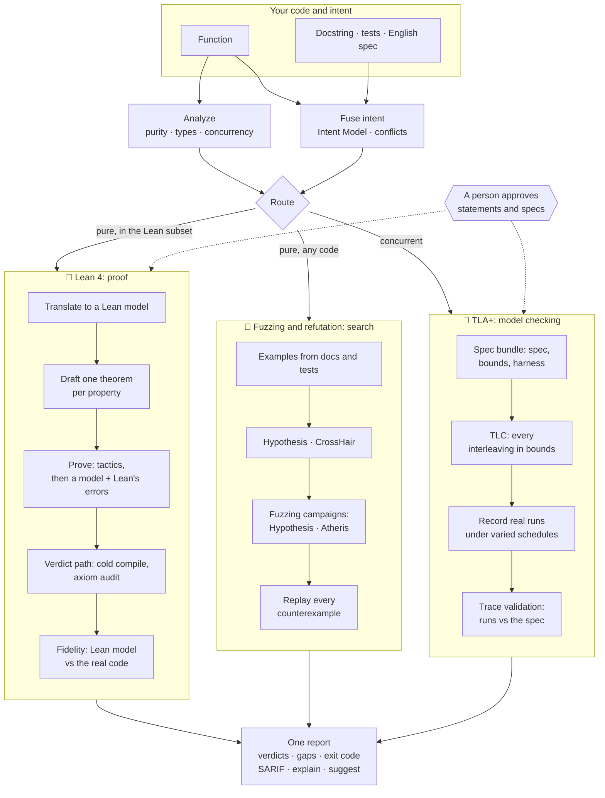

# Apex

### Democratizing Formal Verification for the Agentic Era

**Apex checks whether your Python, JavaScript or TypeScript code does what you said it should,
using three verification engines behind one honest report:**

| Engine | What it does | Answers |
|---|---|---|
| 🧮 **Lean 4 proofs** | proves a property mathematically, for *every* possible input | "Is this always true?" |
| 🔀 **TLA+ model checking** | explores *every* interleaving of concurrent code within bounds, and checks that real runs match the model | "Can threads ever break this?" |
| 🎯 **Fuzzing and refutation** | hammers the *real* code with generated, coverage-guided and symbolic inputs | "Can I find an input that breaks it?" |

You give Apex a function and whatever description of its behaviour you already have: a
docstring or JSDoc, a few tests (pytest, Hypothesis, Jest, Vitest, fast-check), or a couple of
sentences in plain English. Apex routes each function to the
engines that fit it. A pure function in the supported subset goes to Lean. Code Lean can't model
is fuzzed. Concurrent code gets a TLA+ spec. Every engine runs on the same statement of intent,
and the answers come back in one report:

- ✅ **Proven.** A machine-checked Lean proof that the code meets the statement for every
  input.
- ❌ **Refuted.** A concrete input, or a recorded thread schedule, that makes your real code
  misbehave. It always comes with something you can replay.
- 🔎 **Evidence.** `model_checked` (TLA+) or `fuzzed` (fuzzing): strong, stated with its exact
  bounds, and never passed off as a proof.
- ⚠️ **A gap.** An honest "I couldn't establish this", with the reason and what would have to
  change.

You don't need to know Lean, TLA+ or fuzzing. Apex writes the theorems and specs, runs the
engines, and uses an AI model if you have one to do the tedious parts. It asks a person for one
thing only: to confirm that each statement says what the code is *meant* to do.

One run, three engines. Here a clamp has an off-by-one, an integer square root uses a `while`
loop Lean can't model, and two thread workers share a counter (one of them without a lock):

```sh
apex check shapes.py::clamp search.py::isqrt workers.py::racy_worker workers.py::locked_worker --fuzz 10
```

| function | property | verdict | detail |
|---|---|---|---|
| `shapes.clamp` | P1 | `proven_unreviewed` | 🧮 Lean proved it; statement pending your approval |
| `shapes.clamp` | P2 | `refuted` | input (x=0, lo=-1, hi=0): lo <= x <= hi -> r == x; returns -1 |
| `search.isqrt` | P1 | `fuzzed` | 🎯 no counterexample in 7,087 executions (hypothesis, 10s); not a proof |
| `workers.racy_worker` | T_NoLostUpdate | `refuted` | 🔀 NoLostUpdate broke in a real run (run 9): reached count = 3 after 4 observed states |
| `workers.racy_worker` | T_NeverAhead | `model_checked` | 🔀 TLC: 201 states (N=2, K=2); 5 distinct runs conform; not a proof |
| `workers.locked_worker` | T_NoLostUpdate | `model_checked` | 🔀 TLC: 36 states (N=2, K=2); 1 distinct run conforms; not a proof |
| `workers.locked_worker` | T_NeverAhead | `model_checked` | 🔀 TLC: 36 states (N=2, K=2); 1 distinct run conforms; not a proof |

*(A real run; the engine markers were added and the details shortened. Exit 1, because there are
failures. Fix the off-by-one and approve the statements, and `clamp` becomes `proven`. Add the
lock, and `racy_worker` joins `locked_worker` at `model_checked`. `isqrt` stays `fuzzed`: strong
evidence, honestly labeled, because Lean can't model its loop.)*

> **Status:** research prototype for Python and JavaScript / TypeScript, MIT-licensed, not on
> PyPI yet. Start with the
> [quickstart](docs/QUICKSTART.md), and read [what Apex cannot prove](docs/LIMITS.md) before
> relying on a verdict.

---

## Contents

- [The problem: correctness in the age of AI coding](#the-problem-correctness-in-the-age-of-ai-coding)
- [How Apex answers it](#how-apex-answers-it)
- [What you get back](#what-you-get-back-verdicts)
- [Install](#install)
- [Quick start](#quick-start)
- [Telling Apex what the code should do](#telling-apex-what-the-code-should-do)
- [Using Apex](#using-apex)
  - [On the command line](#on-the-command-line)
  - [With a model doing the hard parts](#with-a-model-doing-the-hard-parts)
  - [Inside a coding agent](#inside-a-coding-agent-skill-and-mcp)
  - [Fuzzing and refutation](#fuzzing-and-refutation)
  - [TLA+ for concurrent code](#tla-for-concurrent-code)
  - [JavaScript and TypeScript](#javascript-and-typescript)
  - [In CI](#in-ci)
  - [Configuration](#configuration)
- [How it works](#how-it-works)
- [Design principles](#design-principles)
- [What you are trusting](#what-you-are-trusting)
- [Limits](#limits)
- [How well it works](#how-well-it-works)
- [Development](#development)
- [Project status](#project-status)
- [License](#license)

---

## The problem: correctness in the age of AI coding

Software is increasingly written by coding agents. A one-line prompt produces a working-looking
function in seconds, and an agent can produce hundreds of them in an afternoon. That changes
where the hard part of programming lives. Writing code is no longer the bottleneck. Knowing
whether the code is right is.

The usual safety nets were built for a slower world, and they strain under this one:

- **Review doesn't scale with generation.** People can't read code as fast as agents write it,
  and generated code *looks* right. It is idiomatic, well-named and confidently commented,
  which makes it easy to skim past an off-by-one.
- **Tests check examples, not behaviour.** A test suite tries a handful of inputs someone
  thought of. Bugs live in the inputs nobody thought of: the empty list, the negative number,
  the boundary.
- **The agent often grades its own homework.** When the same model writes the code and the
  tests, they share the same blind spots. "All tests pass" can mean very little.
- **"It works" is a claim, not evidence.** An agent saying it verified something is just more
  generated text.

The strongest safety nets we have are the **formal methods**:

- **Theorem proving** shows code meets its specification for *every* input.
- **Model checking** explores every way concurrent code can interleave.
- **Systematic fuzzing** throws millions of inputs at code to find the one that breaks it.

Together they have protected operating-system kernels, compilers, cryptography and distributed
systems for decades. But they have stayed out of reach for ordinary code. Each needs specialists
with its own tooling and language (a proof assistant, a specification language, a fuzzing
harness), and weeks of expert work per component.

The agentic era makes this both **more necessary** (more code than anyone can review) and
**newly possible** (AI models are good at the tedious parts of formal work). What has been
missing is a way to let models do that work without letting them decide whether it is correct.

## How Apex answers it

Apex splits the job three ways, so that no single party has to be trusted with everything:

| Role | Who | What they do |
|---|---|---|
| **Propose** | an AI model, your coding agent, or Apex's own heuristics | turn English into formal statements, suggest proofs, draft specs |
| **Decide** | Lean 4, TLC, and your real code under fuzzers | check every proof cold and audit its axioms, model-check specs, run the real code to confirm or refute |
| **Approve** | a person | confirm that each statement says what the code is *for* |

Each engine's result is labeled by how strong it is, and the labels never blur:

| Strength | Verdict | From |
|---|---|---|
| for every input | `proven` | Lean 4, on a person-approved statement |
| for every interleaving, within bounds | `model_checked` | TLA+/TLC, with real runs conforming to the spec |
| no counterexample in N executions | `fuzzed` | fuzzing campaigns on the real code |
| observed failure | `refuted` | any engine, but only once Apex watched the real code fail |

A model can make Apex faster, but it can never make Apex say `proven`. Only a Lean proof of a
person-approved statement does that.

That is what "democratizing" means here: no proof expertise needed, the same guarantees a
verification engineer would insist on, and it meets you where you already work. That means the
command line, CI, or your coding agent: it is tested end to end in Claude Code and Codex, and it
also installs for Gemini CLI, Cursor and VS Code.

Who it is for:

- **Developers** who want more than tests on the functions that matter: arithmetic, bounds,
  sorting, encoders, small algorithms.
- **Teams using coding agents.** The agent writes the code, Apex checks it, and the agent reads
  the counterexample and fixes it. This closed loop has been demonstrated in Claude Code and
  Codex.
- **CI pipelines** that need a machine-readable answer (exit codes and SARIF), not someone's
  impression.

## What you get back: verdicts

Every property gets exactly one verdict. The names are part of the contract and every renderer
shows them verbatim.

| Verdict | Meaning | Exit |
|---|---|---|
| `proven` | Lean proved a statement a person approved. Only standard axioms were used, and the Lean model of the function agreed with the real Python on generated inputs. | 0 |
| `refuted` | A concrete input (or, for concurrent code, a recorded run) on which the real Python breaks the property. Apex watched it happen. | 1 |
| `contradiction` | Two of your intent sources disagree, e.g. the docstring says `f(2) == 6` and a test says `f(2) == 5`. | 1 |
| `fidelity_failed` | The model Apex reasoned about (Lean model or TLA+ spec) does not match the real code, so any result about it was discarded. | 1 |
| `proven_unreviewed` | Lean proved it, but nobody has approved the statement yet. | 2 |
| `proven_conditional` | Proven only under an assumption the code does not state. | 2 |
| `unproven` | No proof and no counterexample within budget, with a reason code. | 2 |
| `out_of_scope` | Apex cannot model this code faithfully (I/O, floats, unsupported constructs), with a reason code. | 2 |
| `fuzzed` | Lean couldn't decide it. A recorded fuzzing campaign on the real code found no counterexample. Evidence, not proof. | 2 |
| `model_checked` | Concurrent code: TLC found no violation of its TLA+ spec within bounds, and real runs match the spec. Evidence, not proof. | 2 |

Exit codes for a whole run: **0** means every approved property is proven, **1** means any
failure, **2** means gaps only, and **3** means a tool error (missing Lean, bad config, a crash,
a timeout).

- Failures always win over gaps.
- A function with no intent counts as a gap, so a run can't pass by checking nothing.
- `fail_on` in the config can promote chosen gaps to failures.

## Install

Requirements, by engine:

| For | You need |
|---|---|
| Apex itself, refutation and Hypothesis fuzzing | Python 3.12+ and [uv](https://docs.astral.sh/uv/) |
| Lean 4 proofs | [elan](https://github.com/leanprover/elan); about 5 GB of disk once for the pinned toolchain and Mathlib cache, shared by every project |
| TLA+ model checking | Java 11+; `apex init --tla` fetches the pinned TLC |
| coverage-guided fuzzing (optional) | the `fuzz` extra (Atheris), built with a libFuzzer-capable clang (Homebrew LLVM on macOS) |
| JavaScript / TypeScript targets | Node.js 22.6+ (runs TypeScript directly; no npm packages) |
| coverage-guided JS fuzzing (optional) | npm; `apex init --js` fetches the pinned Jazzer.js |
| model-assisted proofs and specs (optional) | Claude Code or Codex logged in, or an API key |

Apex is not on PyPI yet; install it from a checkout:

```sh
git clone https://github.com/HyperionAI-Tech/apex && cd apex
uv build && uv tool install dist/apex_verify-*.whl
apex init            # writes apex.toml, fetches the pinned Lean toolchain + Mathlib cache
apex doctor          # everything should be "ok"; optional extras show "warn"
```

Optional extras:

```sh
apex init --tla                                    # pinned TLA+ tools (TLC v1.7.4, checksum-verified)
uv tool install 'dist/apex_verify-*.whl[fuzz]'     # Atheris; on macOS first:
                                                   #   export CLANG_BIN=$(brew --prefix llvm)/bin/clang
```

`apex init` installs into `~/.apex` (`APEX_HOME` moves it), outside the package, so upgrading
Apex keeps the cache. Until it has run, the Lean commands exit 3 with a pointer to `apex init`;
refutation and fuzzing work without Lean. Windows is supported through WSL.

To develop on Apex itself: `uv sync --all-extras && uv run apex init`.

## Quick start

Write a function and say what it should do. Here the docstring does that:

```python
# shapes.py
def clamp(x: int, lo: int, hi: int) -> int:
    """Limit x to the range [lo, hi].

    pre: lo <= hi
    post: lo <= __return__ <= hi
    post: lo <= x <= hi -> __return__ == x

    >>> clamp(5, 0, 3)
    3
    """
    return max(lo, min(x, hi))
```

```sh
apex check shapes.py          # P1, P2 (the post: lines) and E1 (the doctest): proven_unreviewed, exit 2
apex review shapes.py::clamp  # read each statement, in English and in Lean
apex review shapes.py::clamp --approve P1,P2,E1   # in your own terminal
apex check shapes.py          # proven, exit 0
```

Now break it, changing `min(x, hi)` to `min(x, hi - 1)`, and check again. P2 and E1 become
`refuted` with concrete inputs, while P1 (the result stays in range) is still true. Then:

```sh
apex explain                  # what each verdict means, in plain English
apex suggest                  # what to change, plus a pytest regression test per counterexample
```

The [quickstart](docs/QUICKSTART.md) walks through this with real output.

## Telling Apex what the code should do

Apex never infers intent from the code alone; that would only prove the code does what it does.
It reads the intent you already have, from four sources, and fuses it into one **Intent Model**:

| Source | Python | JavaScript / TypeScript |
|---|---|---|
| Doc comment | docstring: doctests (examples), `pre:` / `post:` lines (formal properties) | JSDoc: `@example`, `@pre` / `@post` |
| Tests | `test_<module>.py`: `assert f(...) == v`, `parametrize` rows, Hypothesis `@given` | `<module>.test.ts` / `.spec.ts` (or `__tests__/`): Jest / Vitest `expect(f(...)).toBe(v)`, node:assert, fast-check properties |
| English spec | `<module>.spec.md`: one requirement per list item; a formal reading in backticks makes it checkable | the same |
| Source | leading `assert`s (preconditions) | leading `if (...) throw` guards and `assert(...)` (preconditions) |

A formal hint is a boolean expression over the parameters and the result. In Python it's
Python, with `r` (or `__return__`) for the result and `->` for "implies". In JavaScript it's
JavaScript, with `result` and `==>`, e.g. `lo <= result && result <= hi`:

```markdown
## clamp
- Requires: the range is not empty. `lo <= hi`
- The result lies in [lo, hi]. `lo <= r <= hi`
- Values already in range come back unchanged. `lo <= x <= hi -> r == x`
- It should be fast.            <- no hint: kept as text-only intent (SPEC_AMBIGUOUS)
```

- **Shared claims merge.** The same claim from two sources becomes one property that cites both.
- **Disagreements stop.** When sources disagree, both properties are `contradiction`, and nothing
  about them is checked until you decide which source is right.
- **Models can help.** A model can turn English without a hint into one (`apex intent propose`);
  the result is still only a draft that you approve.

## Using Apex

### On the command line

One command does everything, and each stage is also its own command:

```sh
apex check src/                       # the whole pipeline over files or a package
apex check src/ --sarif apex.sarif    # ... plus SARIF for code-scanning UIs
apex report | explain | suggest       # the last report; plain English; concrete next steps
```

```sh
apex analyze  mathx.py::clamp         # purity, the Lean model, the fused Intent Model
apex scaffold mathx.py::clamp         # writes .apex/lean/mathx/clamp/{Model,Spec}.lean
apex review   mathx.py::clamp         # statements with their review status
apex prove    mathx.py::clamp --tactics-only   # cheap deterministic tactics, then verify
apex verify   mathx.py::clamp         # cold Lean compile + axiom audit + fidelity + refutation
apex refute   mathx.py::clamp         # counterexample search on the real Python only
```

Targets are `path.py::function`. Every command takes `--json` (schemas are published in
`schemas/`), and `report`/`check`/`verify` also take `--markdown`.

### With a model doing the hard parts

Two steps can use a model: formalizing English into hints, and proposing proofs the tactics
can't find. Both are opt-in, and the model can be reached any of these ways:

| `model_provider` | How |
|---|---|
| `claude-code`, `codex` | the coding agent you already have installed and logged in, run headless |
| `anthropic`, `openai` | an API key (`ANTHROPIC_API_KEY` / `OPENAI_API_KEY`) |
| `host` | the agent driving Apex writes hints and proofs itself |
| `none` (default) | no model; every deterministic step still runs |

```sh
apex check src/ --provider claude-code    # formalize, prove with Lean's errors fed back, verify
```

A model's proof is held to the same rules as a hand-written one:

- It is refused before Lean runs if it changes an approved statement or uses a forbidden token
  (`sorry`, `native_decide`, `axiom`, ...).
- Lean's errors and goal states go back to the model for a few more attempts.
- Whatever compiles is judged by the same cold verdict path as anything else.

### Inside a coding agent: skill and MCP

```sh
apex skill install --with-mcp     # the apex-verify skill + the `apex` MCP server, for every harness
```

This installs one canonical [Agent Skill](skill/apex-verify/SKILL.md) that Claude Code, Codex,
Gemini CLI, Cursor and VS Code/Copilot all read, and merges an `apex` entry into each
harness's MCP config. Existing entries are never overwritten. Then ask your agent, in your own
words, to verify a function. The skill:

- runs the pipeline;
- shows Apex's table verbatim;
- asks *you* to approve statements. No tool can approve on your behalf; approval needs an
  interactive terminal.

The MCP server (`apex mcp`) exposes the deterministic commands as typed tools: `apex_analyze`,
`apex_verify`, `apex_refute`, `apex_fuzz`, `apex_tla_check` and more. Rejected proofs come back
with Lean's errors mapped to the line the agent edits, and the goal state. The smoke test
matrix runs real Claude Code and Codex sessions through the full loop: write code, fail
verification, read the counterexample, fix, pass.

### Fuzzing and refutation

Refutation runs on every check:

- the examples from your docstring and tests;
- Hypothesis property-based search;
- CrossHair symbolic execution, which finds needle-in-a-haystack inputs random testing misses.

A **fuzzing campaign** goes further and records what it did. It's for code Lean can't model
(`while` loops, indexing, idiomatic agent code) or properties Lean left open:

```sh
apex fuzz loops.py::isqrt --seconds 30          # Hypothesis campaign, recorded per property
apex fuzz loops.py::isqrt --engine atheris      # coverage-guided libFuzzer
apex check src/ --fuzz 10                       # fuzz whatever Lean leaves open
```

- A clean campaign gives `fuzzed`, with the engine, the number of executions, and how many
  inputs were skipped.
- A counterexample is replayed on the real code and gives `refuted`.
- The evidence lapses when the function or the property changes.

### TLA+ for concurrent code

Lean can't reason about thread interleavings; TLA+ can. A concurrent function (threads, locks,
shared state) gets a bundle in `.apex/tla/<module>/<function>/` with three files:

- `Spec.tla`, the spec (PlusCal is fine);
- `Spec.cfg`, the bounds and invariants;
- `harness.py`, which runs the real code and reports its shared state.

```sh
apex tla draft workers.py::worker               # a model drafts the bundle (or write it yourself)
apex review workers.py::worker --approve T_NoLostUpdate   # you approve the whole bundle
apex tla check workers.py::worker               # TLC on the spec, then the real code against it
```

TLC explores every state of the spec within the bounds. Apex then runs the real code many times
under varied thread schedules, and has TLC check that every recorded run is a behavior the spec
allows:

| What happened | Verdict |
|---|---|
| no violation, and every run matches the spec | `model_checked` |
| an invariant broke in a real run | `refuted` |
| a real run the spec doesn't allow | `fidelity_failed` |
| TLC found a violation no real run showed | `unproven`, with TLC's trace |

### JavaScript and TypeScript

Point Apex at a `.ts`, `.mts`, `.js` or `.mjs` file and it works the same way:

```ts
/**
 * Limit x to the range [lo, hi].
 * @pre lo <= hi
 * @post lo <= result && result <= hi
 * @post lo <= x && x <= hi ==> result === x
 * @example clamp(5, 0, 3) // => 3
 */
export function clamp(x: number, lo: number, hi: number): number {
  return Math.max(lo, Math.min(x, hi));
}
```

```sh
apex check src/                                  # Python and JS/TS files alike
apex check shapes.ts::clamp
apex fuzz search.ts::mix --engine jazzer         # coverage-guided JS fuzzing (apex init --js)
```

**What is the same.** The Lean engine, the search engine, statements, approval, reports, exit
codes, SARIF, MCP and the skill. A JS function is parsed (tree-sitter) and *lowered* into the
same subset the Python translator proves things about, so the proofs are real Lean proofs.
Refutation, fuzzing and the fidelity check always run the **real JavaScript** in Node.

**What JavaScript adds.**

| | |
|---|---|
| Intent | JSDoc `@pre` / `@post` / `@example`; Jest and Vitest `expect(f(...)).toBe(v)`; node:assert; fast-check `fc.property(...)` (its bounds become premises); `<module>.spec.md` |
| Hints | JavaScript expressions: `result` for the return value, `==>` for "implies" |
| Types | TypeScript, or JSDoc `@param {number} x` / `@returns {number}` in plain JS. An untyped function is a gap that says so. |
| `number` | A double: integers are exact only up to 2⁵³. Proofs are `proven_conditional`, under the stated precondition that every intermediate value is a safe integer. Searches skip inputs outside it. |
| `bigint` | Exact. Proofs are fully `proven`. |
| Semantics kept | `%` truncates (`-3 % 2` is `-1`, which catches the classic `n % 2 === 1` oddness bug). Only `Math.floor(a / b)` and `Math.trunc(a / b)` are integer division. `===` on arrays compares identity, so it's refused. |
| Refused | `==` (it coerces types), bitwise operators (32-bit), `this`, classes, `try`, `switch`, strings, floats, indexing, `while`, early returns in loops |
| Impure | `console`, `Math.random`, `Date`, `fs`, `process`, `fetch`, timers, `async`, and mutating an argument, all detected before any code runs |
| Not exported | A gap: Apex only runs exported functions |
| Engines | Lean 4 (proofs), Hypothesis and Jazzer.js (fuzzing). CrossHair and TLA+ are Python-only for now. |

### In CI

```yaml
- run: apex check src/ --sarif apex.sarif   # exit 1 fails the job; gaps (exit 2) pass unless fail_on says otherwise
- uses: github/codeql-action/upload-sarif@v3
  if: always()
  with: { sarif_file: apex.sarif }
```

- **SARIF levels.** In SARIF the verdict is the rule ID. Failures are errors and `unproven` is a
  warning. Evidence verdicts are notes, and proofs carry level `none`.
- **Approvals.** Approvals live in `.apex/reviews.json`; commit it and `proven` reproduces in CI
  without anyone at a terminal.

### Configuration

`apex init` writes an `apex.toml`; every key is optional:

```toml
[apex]
model_provider = "none"            # none | claude-code | codex | anthropic | openai | host
# model = "..."                    # unset: the provider's default
proof_budget_s = 120               # per theorem: Lean time for one compile of its proof
refute_budget_s = 10               # CrossHair time per property
fuzz_budget_s = 30                 # per property: one `apex fuzz` campaign
fuzz_engine = "hypothesis"         # or "atheris"
retries = 4                        # model proof attempts after the first, each fed Lean's errors
llm_parallel = 4                   # theorems a model works on at once
confidence_floor = 0.6             # below this, a property is flagged SPEC_AMBIGUOUS
fail_on = ["refuted", "fidelity_failed", "contradiction"]
review_store = ".apex/reviews.json"
ignore = ["tests/**", "migrations/**"]
```

## How it works

Apex is one pipeline with three verification engines behind it. The shared front half
understands your code and your intent. A router sends each function to the engines that can
answer for it. The shared back half turns every engine's result into one report.



**Shared front half**

1. **Analyze.** Resolve the target and classify it: pure or impure (I/O, globals, randomness,
   floats), concurrent or not, inside the Lean subset or not, and why. A JavaScript or
   TypeScript function is first parsed and lowered into the same subset the Python frontend
   produces, with JS semantics made explicit (truncating `%`, safe-integer `number`).
2. **Fuse intent.** Read docstrings, tests, English specs and leading asserts. Build one Intent
   Model with stable property IDs (P1, P2, ...; E1, ... for examples), and call out conflicts
   between sources.
3. **Route.** Send each function to every engine that can answer for it:

   | Function | Lean | Fuzzing and refutation | TLA+ |
   |---|---|---|---|
   | pure, inside the subset | proves | always runs too | n/a |
   | pure, outside the subset | n/a | refutes or fuzzes | n/a |
   | concurrent | n/a | n/a | model-checks |
   | other impure (I/O) | n/a | n/a | n/a: `out_of_scope`, with the pure core |

**🧮 Lean 4: proof**, the only engine that can say `proven`

4. **Translate** the function into a Lean model. The translator takes a deliberately small,
   exact subset and refuses anything it can't model faithfully.
5. **Draft** one Lean theorem per formal property, using the same translator, so the statement
   and the model speak the same language. A person approves each statement.
6. **Prove** with cheap deterministic tactic tiers (`decide`, `omega`, `simp`, induction), then
   optionally a model in a fixer loop that reads Lean's errors and goal states.
7. **Judge** on the verdict path: a cold compile, a screen for tricks (`sorry`,
   `native_decide`, forged output), and an axiom audit against a fixed allowlist.
8. **Cross-check** the compiled Lean model against the real code on 200 generated inputs. Any
   disagreement discards the proof as `fidelity_failed`.

**🎯 Fuzzing and refutation: search on the real code**

9. **Refute** on every check, using the examples from docs and tests, Hypothesis property-based
   search and CrossHair symbolic execution.
10. **Fuzz** with a recorded campaign when asked (`apex fuzz`, `apex check --fuzz`), using
    Hypothesis or coverage-guided Atheris.
11. **Replay** every counterexample on the real code before it becomes `refuted`. A clean
    campaign gives `fuzzed`.

**🔀 TLA+: model checking concurrent code**

12. **Specify** the code in a bundle: spec, bounds and invariants, plus a harness that runs the
    real code. A model drafts it, and a person approves it.
13. **Model-check** with TLC, which explores every interleaving the spec allows within the bounds.
14. **Validate** the spec against reality. The real code runs many times under varied thread
    schedules, and TLC checks that each recorded run is a behavior of the spec. An invariant
    broken in a real run is `refuted`, and a run the spec doesn't allow is `fidelity_failed`.

**Shared back half**

15. **Report** one verdict per property, with reason codes, next steps and the run's exit code.
    The output is Rich, Markdown, JSON or SARIF, plus `apex explain` (plain English) and
    `apex suggest` (fixes and regression tests).

The code is organized the same way:

| Layer | Package | Role |
|---|---|---|
| Contracts | `apex.core` | verdicts, reason codes, Intent Model, report, config, JSON Schemas |
| Front half | `apex.analyze`, `apex.intent` | analysis and routing facts; intent mining and fusion |
| JS frontend | `apex.js` | tree-sitter parsing, lowering to the shared subset, JSDoc/Jest/fast-check mining, the Node bridge, Jazzer.js |
| 🧮 Lean engine | `apex.translate`, `apex.theorems`, `apex.prove`, `apex.lean` | translation, statements and review, proof search, pinned Lean project and verdict path |
| 🎯 Search engine | `apex.fidelity` | refutation, fuzzing campaigns, and the fidelity bridge back to the Lean engine |
| 🔀 TLA+ engine | `apex.tla` | bundles, pinned TLC, run recorder, trace validation, drafting |
| Models | `apex.llm` | providers: agent CLIs or API keys (proposals only) |
| Surfaces | `apex.cli`, `apex.mcp`, `apex.skill`, `apex.report` | CLI, MCP server, Agent Skill installer, renderers |
| Orchestration | `apex.pipeline` | the deterministic verbs every surface calls |

Every surface (CLI, MCP, skill) calls the same pipeline functions, so they cannot drift apart.
Deeper internals, engine by engine, are in [docs/ARCHITECTURE.md](docs/ARCHITECTURE.md).

## Design principles

1. **Three engines, one honest scale.** Each engine answers a different question. Its verdict
   says exactly how strong the answer is (every input, every interleaving within bounds, N
   executions, or one observed failure), and the scale never blurs.
2. **Only Lean says `proven`.** Not a model, not an agent, not a fuzzing campaign, not TLC.
   `model_checked` and `fuzzed` are evidence: gaps, never passes.
3. **Models propose; engines decide.** Every model output (hints, proofs, TLA+ bundles) goes
   through a deterministic check before it can affect a verdict.
4. **A person approves meaning.** An engine can check a proof or a spec. Only a person can say
   whether it states what the code is *for*. Approval needs an interactive terminal, so an agent
   can never approve its own work.
5. **Every model is checked against the real code.** Lean models are cross-checked by the
   fidelity bridge, and TLA+ specs by trace validation. A result about the wrong model is
   discarded, not reported.
6. **Failures are observed, never inferred.** `refuted` means Apex ran the real code and watched
   it fail, from any engine. A violation found only in a model stays a gap.
7. **Refusing beats approximating.** What an engine can't model exactly is a gap with a reason,
   because a proof about the wrong model is worse than no proof.
8. **Gaps are first-class output.** Every gap carries a reason code and next steps. Exit 0 can't
   happen by checking nothing.
9. **Everything is pinned.** Lean, Mathlib and TLC are pinned by version and checksum, and
   upgrades are deliberate changes re-run against the eval corpus.

## What you are trusting

| Verdict | Rests on |
|---|---|
| `proven` (Lean) | the Lean 4 kernel and pinned Mathlib (axioms: only `propext`, `Classical.choice`, `Quot.sound`); the **approved statement** (Lean proves exactly what it says); the **translator** (the proof is about Apex's Lean model; the fidelity check tests that model against the real code, but testing isn't proof) |
| `model_checked` (TLA+) | TLC; the **approved bundle**, especially the harness, whose `observe()` defines what "conforms" means; the **bounds** in `Spec.cfg`; the recorded runs, which sample schedules rather than cover them all |
| `fuzzed` (fuzzing) | the campaign's **coverage** (inputs it never generated can still break the property) and the property's hint (a vacuous hint fuzzes clean) |
| `refuted` (any) | nothing beyond Python itself: Apex ran the real code and watched it fail, and you can replay it |

All of them are partial-correctness claims: preconditions (leading `assert`s, `pre:`,
"Requires:") bound every claim, and outside them the function promises nothing.

## Limits

The short version (the full list is in [docs/LIMITS.md](docs/LIMITS.md)):

- **🧮 Lean: the subset is small.**
  - Not supported: `str`, `float`, `dict`, `set`, classes, `while` loops, recursion, indexing,
    early `return` in loops, exceptions, module constants, and calls into other modules.
  - Of 10 functions written by Claude Code and Codex from one-line prompts, 3 fall inside it.
    The other 7 go to the search engine instead.
  - Many functions fit after a small rewrite, and the gap message points at the line.
- **🎯 Fuzzing: `fuzzed` can sit on top of a bug.** A 20-second campaign once missed a planted
  bug that a 60-second one finds. CrossHair, not the fuzzers, is what catches exact-value
  needles.
- **🔀 TLA+: results hold within bounds only.**
  - Two threads and two iterations is not N threads.
  - Only invariants are checked, not temporal properties.
  - A spec is only checked against the schedules the runs happened to hit.
- **JavaScript: `number` proofs are conditional.**
  - They hold only while every intermediate value is a safe integer; use `bigint` for
    unconditional proofs.
  - CrossHair and TLA+ are Python-only for now.
  - Only exported functions can be run.
- **All engines: no performance claims.** "Runs in linear time" has no formal reading and stays
  text-only.

## How well it works

The eval corpus gates every phase. It has 171 cases, 126 in Python and 45 in JavaScript /
TypeScript:

| Category | Python | JS / TS |
|---|---|---|
| known-good functions, most with hand-written Lean reference statements | 49 | 19 |
| planted bugs | 33 | 8 |
| spec/code conflicts | 15 | 3 |
| out-of-scope functions | 15 | 9 |
| unedited agent-written functions (Claude Code, Codex) | 10 | 6 |
| concurrent functions with TLA+ bundles | 4 | |

`uv run python evals/run.py --jobs 4` prints this scoreboard (tactics only, no model):

| | |
|---|---|
| **false `proven`** (must be 0) | **0** |
| **false evidence**: `fuzzed`/`model_checked` on a property that must fail (must be 0) | **0** |
| cases matching their expected verdicts | 171 / 171 (Python 126/126, JS/TS 45/45) |
| planted bugs caught with a counterexample | 63 / 63 (two only a fuzzing campaign finds) |
| spec/code conflicts detected | 22 / 22 |
| out-of-scope functions with the right reason code | 24 / 24 |
| drafted statements Lean shows equivalent to the hand-written reference | 67 / 99 |
| true properties proven (JS `number` ones as `proven_conditional`) | 168 / 294 (tactics alone) |
| agent-written functions inside the Lean subset | 7 / 16 |
| evidence verdicts | 24 `fuzzed`, 3 `model_checked` |
| median time per function | 8.7 s |

With a model in the proof loop (`--provider claude-code`), the earlier 46-case corpus went from
56/82 to 82/82 true properties proven, with false `proven` still 0. That run hasn't been
repeated on the full corpus yet.

## Development

```sh
uv sync --all-extras && uv run apex init      # add `apex init --tla` for the TLA+ tests
uv run pytest -m "not lean and not install"   # unit tests (TLA+ tests skip without Java/TLC)
uv run pytest -m lean                         # Lean canaries and end-to-end tests
uv run pytest -m install                      # builds the wheel and drives the installed binary
uv run python evals/run.py --jobs 4           # the eval corpus and scoreboard
uv run python evals/smoke/run.py              # real agents drive the skill (spends model usage)
uv run ruff check . && uv run pyright
```

The canaries include proofs that try to cheat (`sorry`, `admit`, `native_decide`, a user
`axiom`, a forged audit line). Each asserts that the axiom audit alone rejects it, so a guard that
happens to fire first can never hide a regression in the trust anchor.

```
src/apex/        the package (see "How it works")
lean/            the pinned Lake project: Lean v4.35.0, Mathlib v4.35.0, the Apex prelude
skill/           the canonical apex-verify Agent Skill
packaging/       generated Claude Code plugin and Gemini CLI extension
evals/           the corpus, the runner, and the agent smoke matrix
schemas/         JSON Schemas for every --json output
docs/            quickstart, limits, architecture
tests/           unit, Lean, install and TLA+ tests; canaries; TLC output fixtures
```

## Project status

Apex has been built phase by phase against the development handoff:

| Phase | Delivered |
|---|---|
| 0 | Lean harness: pinned toolchain, cold verdict compiler, axiom audit, canary suite |
| 1 | Python spine: translation, statements, review, fidelity bridge, first proofs |
| 2 | Four intent sources, fusion and conflicts, refutation, model providers |
| 3 | `apex check`, model proof search, SARIF, the exit-code contract |
| 4 | MCP server and Agent Skill, verified in Claude Code and Codex |
| 5 | Hardening: the 126-case corpus, quickstart, limits page |
| 6 | The search and TLA+ engines: fuzzing campaigns, TLA+ model checking for concurrent code |
| 7 | JavaScript and TypeScript: lowering to the shared subset, the Node bridge, JSDoc / Jest / fast-check intent, Jazzer.js |

Still open:

- **Decisions:** the PyPI package name (`apex-verify` is a placeholder), the default model
  provider, the maturity claim, and the skill's distribution channels.
- **Not yet verified:**
  - the CI jobs for TLA+ and Atheris;
  - a native Linux install;
  - the API-key providers;
  - the Gemini extension format.

## License

Apex is released under the [MIT License](LICENSE).
